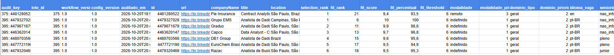
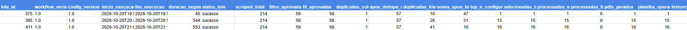

# Automated Data & BI Job Search Pipeline with n8n

An end-to-end automation project built with **n8n, JavaScript and local LLMs** to support the discovery, evaluation and processing of Data, Business Intelligence and Analytics job opportunities.

The pipeline collects job listings, applies deterministic eligibility rules, calculates candidate-job compatibility, removes duplicates, ranks the strongest opportunities and generates role-specific one-page resumes.

The project was designed with one central principle:

> **Critical decisions are deterministic. Generative AI is used only for controlled text personalization.**

> **Repository scope:** This repository documents the architecture, design decisions and results of the project. Production workflow exports, private configuration and sensitive operational data are intentionally not published.

---

## Project Overview

Searching for relevant Data and BI opportunities manually involves several repetitive steps:

- reviewing large volumes of job listings;
- checking location and work modality;
- identifying seniority and experience requirements;
- comparing technical requirements against the candidate profile;
- avoiding duplicate applications;
- prioritizing stronger opportunities;
- adapting the resume for each position;
- tracking what has already been processed.

This project automates that workflow while keeping the decision process auditable and explainable.

The system is divided into two n8n workflows.

---

## Architecture

### Workflow A — Job Discovery, Filtering and Ranking


Workflow A is responsible for:

1. loading the execution configuration and candidate profile;
2. collecting Data / BI / Analytics vacancies;
3. applying deterministic eligibility rules;
4. calculating a deterministic Fit Score;
5. removing duplicates from the current collection;
6. removing opportunities already processed in previous executions;
7. ranking the remaining jobs;
8. selecting the Top N opportunities;
9. sending each vacancy individually to Workflow B;
10. generating vacancy-level audit records and batch execution metrics.

### Workflow B — Resume Personalization and Persistence


Workflow B receives one vacancy at a time.

It handles:

1. controlled LLM-based text personalization;
2. resume content validation;
3. deterministic fallbacks when generated content is rejected;
4. one-page resume generation;
5. document and PDF creation;
6. operational tracking;
7. permanent job history registration;
8. final processing status.

Processing jobs individually also prevents one failed vacancy from interrupting the entire batch.

---

## How the Pipeline Works

```text
LinkedIn Job Collection
        ↓
Deterministic Eligibility Filter
        ↓
Deterministic Fit Score
        ↓
Fit Threshold
        ↓
Current-Batch Deduplication
        ↓
Historical Deduplication
        ↓
Top-N Ranking
        ↓
Process One Vacancy at a Time
        ↓
LLM Text Personalization
        ↓
Validation & Guardrails
        ↓
One-Page Resume Generation
        ↓
Operational Tracking + History
        ↓
Audit Trail + Execution Summary
```

---

## Deterministic Filtering

Before any generative AI is used, each vacancy passes through a deterministic JavaScript filter.

The filter evaluates criteria such as:

- work modality;
- geographic compatibility;
- seniority;
- minimum required experience;
- blocked companies;
- role/domain restrictions;
- job language.

Hard eligibility decisions therefore do not depend on LLM interpretation.

This makes the pipeline more reproducible and reduces unpredictable decisions.

---

## Fit Scoring

Eligible vacancies receive a deterministic candidate-job compatibility score.

The Fit engine compares the vacancy against the candidate profile using signals such as:

- technical requirements;
- responsibilities;
- BI and analytics tools;
- programming languages;
- data quality;
- reporting and dashboards;
- business/domain requirements;
- language requirements;
- required professional experience.

The Fit Score measures **compatibility**, while the previous filtering stage determines **eligibility**.

These are intentionally separate concepts.

---

## Ranking Strategy

After filtering and deduplication, vacancies are ranked according to the following priority:

1. Work modality
2. Business domain
3. Fit Score
4. Posting recency
5. Number of applicants

This prevents raw semantic similarity from overriding important operational preferences.

The number of vacancies sent for processing is controlled by a centralized `Top N` configuration.

---

## Deduplication

The project contains two deduplication layers.

### Current-Batch Deduplication

Prevents duplicate or highly similar listings collected during the same run.

### Historical Deduplication

Compares new opportunities against previously processed vacancies, primarily using LinkedIn job IDs and job URLs.

This prevents the same opportunity from being processed repeatedly across different executions.

---

## Controlled Use of Generative AI

LLMs are intentionally isolated from critical decision-making.

They do **not** decide:

- job eligibility;
- work modality;
- seniority;
- Fit Score;
- ranking;
- deduplication.

LLMs are used only to personalize resume text such as:

- professional summary;
- technical skills;
- professional experience wording.

The candidate resume remains the source of truth.

> **The job description determines relevance. The candidate resume determines the facts.**

---

## Resume Validation and Guardrails

Generated content is validated before being included in the final resume.

The validation layer checks for issues such as:

- unsupported candidate facts;
- unsupported numerical claims;
- inflated seniority;
- incorrect language;
- structural inconsistencies;
- unsafe or malformed generated content.

When generated content fails validation, the system falls back to deterministic, CV-grounded text instead of accepting unreliable content.

The final generator also handles:

- PT-BR and English resumes;
- deterministic headlines;
- project selection based on relevance;
- one-page layout;
- clickable portfolio links;
- safe fallback content.

---

## Auditability and Monitoring

The pipeline creates two complementary monitoring datasets.

### Vacancy Audit Trail



Each selected vacancy records information such as:

- selection rank;
- Fit Score;
- modality;
- business domain;
- required experience;
- candidate experience;
- strongest matches;
- warnings;
- selection rationale;
- processing status;
- PDF generation status;
- historical registration status.

This makes it possible to understand why a specific vacancy was selected.

### Execution Summary



Each workflow run produces one batch-level record containing metrics such as:

- collected vacancies;
- filter-approved vacancies;
- Fit-approved vacancies;
- duplicates removed;
- historical duplicates;
- new opportunities;
- selected Top N;
- processing successes and failures;
- generated resumes;
- average Fit Score;
- modality distribution;
- language distribution;
- configuration snapshot.

A shared `batch_id` connects execution-level metrics with vacancy-level audit records.

---

## Example Validation Run

One production-like validation run processed the following funnel:

```text
214 jobs collected
 ↓
59 passed deterministic filtering
 ↓
58 passed the Fit threshold
 ↓
57 remained after current-batch deduplication
 ↓
10 historical duplicates removed
 ↓
47 new opportunities remained
 ↓
Top opportunity selected for end-to-end validation
 ↓
Resume generated successfully
 ↓
Operational record created
 ↓
Historical record created
 ↓
Audit and execution metrics recorded
```

The same pipeline can process a configurable Top N batch, with the current production configuration designed for the strongest opportunities from each execution.

---

## Centralized Configuration

Operational parameters are centralized in a dedicated configuration node.

Examples include:

- Top N vacancies;
- Fit threshold;
- maximum accepted experience requirement;
- blocked companies;
- accepted hybrid locations;
- maximum on-site frequency.

This separates operational configuration from the internal logic of filtering and scoring.

---

## Technology Stack

- n8n
- JavaScript
- Apify / LinkedIn job data
- Ollama
- Local Large Language Models
- Google Sheets
- Google Docs
- HTML
- PDF generation
- Git / GitHub

---

## Current Project Version

```text
Workflow A:             v1.0
Deterministic Filter:   1.2.4
Fit Engine:             OR Groups v1.1
Collection Dedupe:      1.3
Historical Dedupe:      1.1
Resume Generator:       3D.9
Audit Trail:            1.0
Execution Summary:      1.0
```

---

## Privacy and Repository Scope

This repository is intended as a technical case study of the architecture and engineering decisions behind the project.

Production workflow exports, credentials, candidate personal information, API configuration and private operational data are intentionally not included.

The screenshots and documentation focus on the system design rather than exposing production secrets.

---

## Possible Future Improvements

Future iterations may include:

- application-status tracking;
- interview and rejection analytics;
- conversion-rate analysis;
- automatic retry queues;
- configurable rules through an external control panel;
- weekly job-market analytics;
- feedback loops based on interview outcomes;
- automated regression testing using synthetic vacancy descriptions.

---

## Project Status

**Version 1.0 — Functional**

The core pipeline has been validated end-to-end with real job listings, including filtering, Fit scoring, ranking, historical deduplication, resume generation, persistence, vacancy-level auditing and batch-level monitoring.
